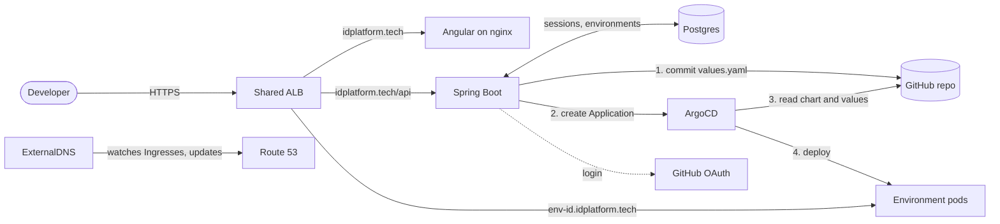

# Internal Developer Platform

A self-service portal where a team fills in a form and gets a running environment on AWS, with its own HTTPS address, in about two minutes. Nobody writes Kubernetes YAML or opens a ticket.

The portal never touches the cluster directly. It writes the environment's configuration to Git, and ArgoCD deploys whatever Git says (GitOps). Environments delete themselves when their time runs out, so forgotten ones don't keep costing money.

**Stack:** Spring Boot 4 · Angular 19 · Helm · ArgoCD · Terraform · AWS (EKS, ALB, ECR, Route 53, ACM) · GitHub Actions

## What it does

| Feature | How it works |
|---|---|
| **Self-service environments** | Pick a team, a type and one or more container images. Each service gets a Deployment, a Service and an Ingress path in its own namespace. |
| **GitOps deployment** | The backend commits a `values.yaml` to Git and registers an ArgoCD Application. ArgoCD renders the Helm chart and keeps the cluster matching Git. |
| **Automatic expiry** | Every environment has a lifetime of 1 to 72 hours. A scheduled job destroys it when that runs out. |
| **Its own HTTPS address** | Each environment is served at `https://<env-id>.idplatform.tech`. ExternalDNS creates the DNS record and removes it afterwards. |
| **One shared load balancer** | All environments join one ALB through an Ingress group instead of paying for one each. |
| **GitHub login** | OAuth2 sign-in, limited to an allowed list of usernames. Sessions are stored in Postgres so every backend replica shares them. |
| **Live status** | Sync and health come straight from ArgoCD, and the detail page polls until the environment settles. |
| **Config for your app** | Each service can set environment variables and a health check path, used by both the readiness probe and the load balancer. |
| **Safe failure** | A failed create rolls back its Git commit and ArgoCD app. A failed destroy keeps its database row, so it can be retried. |

## Architecture



### Creating an environment

1. The form posts to `POST /api/environment/create`.
2. The backend generates an ID like `dev-payments-mw1abc` and writes `environments/<id>/values.yaml`, then commits and pushes it to the `dev` branch.
3. The backend creates an ArgoCD Application pointing at `charts/environment` with that values file.
4. ArgoCD renders the chart into the environment's namespace.
5. The AWS Load Balancer Controller adds the environment's rules to the shared ALB.
6. ExternalDNS creates `<id>.idplatform.tech` in Route 53.
7. The portal polls ArgoCD until the environment is Healthy, then shows its URL.

If step 3 or the database save fails, the backend removes the ArgoCD app and the Git folder, so no half-created environment is left running.

### Deploying the platform itself

Pushing to `dev` runs GitHub Actions: build, tests, a Trivy scan, then Docker images pushed to ECR. CI commits the new image tag to `k8s/`, and ArgoCD rolls it out. Nothing in CI talks to the cluster.

## Repository layout

```
idp-backend/         Spring Boot API (REST, GitOps, ArgoCD client, cleanup job)
idp-frontend/        Angular portal (Dockerfile = dev server, Dockerfile.prod = nginx)
charts/environment/  Helm chart rendered once per environment
environments/        One values.yaml per live environment, written by the backend
k8s/                 The platform's own manifests, deployed by ArgoCD
argocd/              The ArgoCD Application that deploys k8s/
terraform/           All AWS infrastructure
.github/workflows/   CI/CD pipeline
docs/                Runbooks and the full project guide
```

## Run it locally

You need Docker, and a GitHub OAuth App with callback `http://localhost:4200/api/login/oauth2/code/github`.

Create a `.env` file in the repository root:

```
GIT_PASSWORD=<GitHub token with Contents write on this repo>
GITHUB_CLIENT_ID=<OAuth App id>
GITHUB_CLIENT_SECRET=<OAuth App secret>
```

Then:

```bash
docker compose up --build
```

Open <http://localhost:4200>. Creating real environments also needs a cluster: set `ARGOCD_URL` and `ARGOCD_TOKEN` in `.env`.

## Deploy to AWS

The step-by-step runbooks cover every command, what to expect and how to fix common failures:

- [Bring everything up](docs/runbook-apply.pdf), about 35 minutes
- [Tear everything down](docs/runbook-destroy.pdf), about 25 minutes

[The project guide](docs/project-guide.pdf) explains how every part works and why it was built that way.

## API

Everything except the health check needs a signed-in session. POST and DELETE also need the CSRF header, which Angular sends automatically.

| Method | Path | Purpose |
|---|---|---|
| `GET` | `/api/me` | The signed-in user. Returns 401 if not signed in. |
| `GET` | `/api/environment` | List environments |
| `POST` | `/api/environment/create` | Create an environment |
| `GET` | `/api/environment/{id}` | One environment |
| `GET` | `/api/environment/{id}/status` | Live sync, health and URL from ArgoCD |
| `DELETE` | `/api/environment/{id}` | Destroy an environment |
| `GET` | `/api/oauth2/authorization/github` | Start GitHub sign-in |
| `POST` | `/api/logout` | Sign out |
| `GET` | `/actuator/health` | Public. Used by the load balancer. |

## Known limitations

- **Environment variables are stored in plain text** in this public repository, so they must not hold secrets. The form warns about this. There is no secrets support yet.
- **No quotas.** Anyone on the allowed list can create as many environments as the cluster will hold.
- **Environments can't be edited.** Changing one means destroying it and creating another.
- **Terraform state is local**, so only one person can safely run it.
- **No monitoring** beyond ArgoCD's health status.
- **Redis is provisioned but unused**, left over from an earlier design.

## Roadmap

Quotas · editing environments · secrets from a vault · remote Terraform state (S3) · Prometheus and Grafana · a database per environment.
